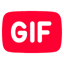

  

<h1 align="center">MemeTube Pro</h1>

  <strong>Post animated Tenor GIFs, viral ASCII memes, and Kaomoji in YouTube & Shorts comments.</strong>

  
  
  
  
  

  <a href="#demo">Demo</a> ·
  <a href="#why-memetube-pro">Why MemeTube Pro?</a> ·
  <a href="#features">Features</a> ·
  <a href="#install">Install</a> ·
  <a href="#shortcuts">Shortcuts</a> ·
  <a href="#how-it-works">How It Works</a> ·
  <a href="#troubleshooting">Troubleshooting</a> ·
  <a href="#privacy">Privacy</a>

---

## Demo

<!-- Kéo thả video hoặc ảnh GIF demo của bạn vào đây trên GitHub -->

  <em>Attach your demo GIF / video preview here</em>

---

## Why MemeTube Pro?

Since mid-October 2026, YouTube started rejecting native desktop GIF comments with `HTTP 400 (INVALID_ARGUMENT)`. Legacy extensions that rely on YouTube's internal mobile API endpoints broke down completely.

**MemeTube Pro** solves this by adopting a **client-side inline rendering architecture** (similar to BetterTTV / 7TV on Twitch). It encodes GIF references via lossless zero-width characters:
- **Users with MemeTube Pro:** Experience seamless animated GIFs rendered directly beneath comment threads.
- **Users without the extension (Mobile / Stock desktop):** See clean, uncorrupted text comments with zero broken codes or exposed URLs.

---

## Features

- **🎬 Tenor GIF Search & Live Preview:** Search millions of GIFs directly from Tenor. A live preview card appears in your comment box before posting.
- **🔒 Persistent Attachment Guard:** Freely type, edit, backspace, or rewrite your comment — the selected GIF stays safely locked until you decide to remove it.
- **✨ Zero-Width Stealth:** Uses invisible zero-width unicode characters to embed metadata. No ugly shortcodes like `[gif:...]` or long raw URLs.
- **🎨 Viral ASCII / Braille Art:** One-click insertion of 30+ classic ASCII memes (Doge, GigaChad, Pop Cat, Moai) perfectly formatted for YouTube comments.
- **🌸 Kaomoji & Braille Studio:** 60+ expressive Japanese emoticons and an integrated Image-to-Braille converter.
- **⚡ Shorts & Desktop Ready:** Works across YouTube desktop video pages and YouTube Shorts comment drawers.

---

## Install

### Chrome, Brave, Edge, Cốc Cốc

1. Download the latest **`memetube-pro-v10.1-safe.zip`** from [Releases](https://github.com/minhkhanh13/gif-youtube-AI/releases/latest).
2. Extract the ZIP archive to a folder on your computer.
3. Open your browser and navigate to `chrome://extensions` (or `brave://extensions`).
4. Enable **Developer mode** using the toggle in the top-right corner.
5. Click **Load unpacked** and select the extracted folder (the one containing `manifest.json`).
6. Refresh any open YouTube tabs and start commenting!

---

## Shortcuts

| Key Combination | Action |
| --- | --- |
| <kbd>Ctrl</kbd> + <kbd>Enter</kbd> | Submit the comment with the attached GIF |
| <kbd>Esc</kbd> | Close the Meme / GIF Studio modal |
| <kbd>Enter</kbd> (in Tenor search) | Trigger instant search query |

---

## How It Works

MemeTube Pro operates entirely in the browser without third-party proxy servers:

| Component | Scope | Responsibility |
| --- | --- | --- |
| `src/content.js` | YouTube DOM | Injects the Meme button, handles the Live Preview card, and encodes/decodes zero-width attachments |
| `src/content.css` | YouTube UI | Theme-adaptive styling for the modal, buttons, preview cards, and rendered GIF players |
| `src/sw.js` | Service Worker | Handles background Tenor API calls and fallback blob fetching to avoid CORS / CSP blocks |

---

## Troubleshooting

| Problem | Root Cause | Solution |
| --- | --- | --- |
| The Meme button doesn't appear | YouTube dynamic navigation didn't trigger reload | Refresh the YouTube page once. |
| GIF renders as a blank / black box | CDN path mismatch on legacy versions | Update to v10.1 LTS which includes lossless Tenor CDN resolution. |
| Text comment disappeared | Comment node styling glitch | Update to v10.1 LTS. User text comments are 100% preserved above the GIF. |
| Mobile users see raw links | Unencoded URL submission | MemeTube Pro uses zero-width stealth encoding; update to v10.1 LTS to eliminate raw URLs. |

---

## Privacy

- **No Data Collection:** MemeTube Pro does not collect personal data, track browsing activity, or use analytics.
- **No Third-Party Intermediaries:** Search queries go directly to Tenor's official API, and GIF assets are fetched straight from Tenor CDN servers.
- **Credentials Protected:** The extension never inspects, accesses, or modifies your YouTube login credentials or cookies.

---

## Support & Contributing

If you find MemeTube Pro helpful, please consider giving it a ⭐ on GitHub! Pull requests and feature suggestions are always welcome.

## License

Distributed under the [MIT License](LICENSE).

https://github.com/user-attachments/assets/7f4807b3-c133-4d66-bf13-e6641c2b8eee

